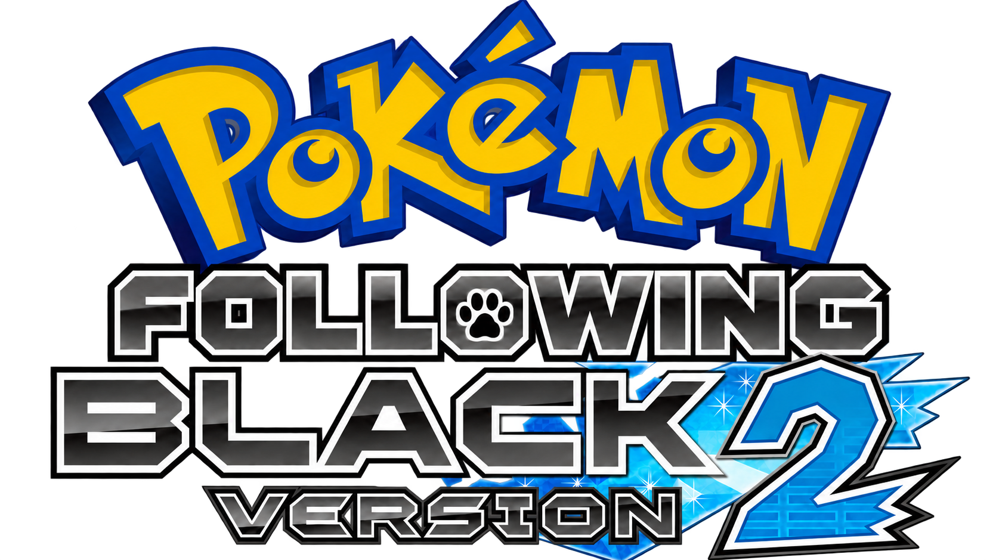
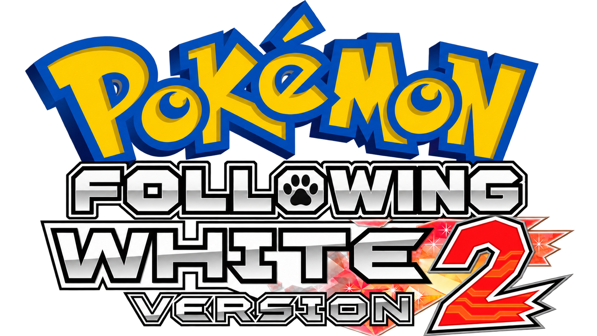

# Pokémon Following Black & White 2

**A familiar Unova, with your Pokémon beside you.**

Following Pokémon, expressive battle scenery, and a little more room to enjoy the journey.

[**↓ Download the latest patches**](https://github.com/omgkai/Following-Black-White-2/releases/latest) · [Getting started](PATCHING.md) · [What's new](CHANGELOG.md) · [Report a bug](https://github.com/omgkai/Following-Black-White-2/issues)

English Black 2 / White 2 · DSi Enhanced ROMs · xdelta patches

---

## Your partner belongs in the adventure

Following Black & White 2 brings your lead Pokémon into the world around you. Talk to your companion, see it take part in familiar scenes, and revisit Unova with the original adventure at its heart.

| Beside you | A world with more life | Play at your own pace |
| :--- | :--- | :--- |
| Following Pokémon and context-aware conversations. | Expressive battle backgrounds in supported areas. | Optional experience, level-cap and scaling settings. |
| Partner gifts and nearby hidden-item alerts. | Animated scenery and available seasonal variants. | Configurable wild/trainer randomization and shiny settings. |
| Followers integrated into story moments. | Manual trainer rematches, including Gym Leaders; postgame leader rematches use PWT teams. | Free party-menu Move Relearner, portable BOX access and IV/EV viewing. |

The focus stays on Gen 5 and the original Black 2 / White 2 adventure. Custom backgrounds cover selected areas; additional scenery and postgame work remain unfinished.

## Download

**GitHub Releases is the home for current downloads and update notes.** Use the latest-release link above whenever you return for an update.

| Your game | Current patch |
| :--- | :--- |
| Pokémon Black 2 | [Following Black 2 · v0.9.98](https://github.com/omgkai/Following-Black-White-2/releases/download/v0.9.98/Following-Black-2-v0.9.98.xdelta) |
| Pokémon White 2 | [Following White 2 · v0.9.98](https://github.com/omgkai/Following-Black-White-2/releases/download/v0.9.98/Following-White-2-v0.9.98.xdelta) |

> **Hardware compatibility update:** v0.9.98 fixes the nds-bootstrap Summary freeze and restores Black 2’s complete DSi code sections. **Black 2’s required original has changed.** Existing battery saves can be kept. Read the [patching guide](PATCHING.md) before updating.

These downloads are patches. Bring your matching original English **DSi Enhanced** ROM and apply the patch for that game. [Patching instructions and supported source hashes →](PATCHING.md)

## Your first steps

1. Download the patch for your game from [Releases](https://github.com/omgkai/Following-Black-White-2/releases/latest).
2. Apply it to the matching original ROM with an xdelta3-compatible patcher, choosing a new output filename.
3. Start normally through **Continue** or **New Game**. To keep existing progress, back up your battery `.sav` and match its base filename to the patched ROM.
4. Explore the game's options to choose the experience, scaling and convenience settings you want.

Older emulator states restore older loaded code and memory. Use a normal boot when checking an update; applying another patch on top of an already modified ROM is not supported.

## Updates & support

The [changelog](CHANGELOG.md) records releases, and each [GitHub Release](https://github.com/omgkai/Following-Black-White-2/releases) keeps its own downloads and notes. This repository is the official download and update page for the project.

If something goes wrong, [open an issue](https://github.com/omgkai/Following-Black-White-2/issues/new) with your game, patch version, emulator/device, steps to reproduce, and whether you started normally or loaded an older state. Screenshots or recordings are useful. Do not upload ROM files or personal saves to a public issue.

This is an as-is community release. Kai played through the main campaign during development; the v0.9.98 hotfix also has targeted offline regressions. Every hardware, battle effect and camera combination has not been verified. Kai confirmed the Summary fix on DSi hardware in DS mode and reported DSi mode working after first booting in DS mode. Hardware coverage is not exhaustive; compatibility with other hacks remains unverified. Some transport sequences recall the follower where the original scene supports only one actor.

## About the project

Created by **Kai**. Development used AI assistance for code implementation and review, with the design, dialogue, presentation and playtesting directed by Kai.

Pokémon and the original game artwork belong to their respective owners. This is an unofficial fan project.

**With love, from Kai.**

[KeepSake](https://github.com/omgkai/KeepSake) · [Allure](https://github.com/omgkai/Allure)

